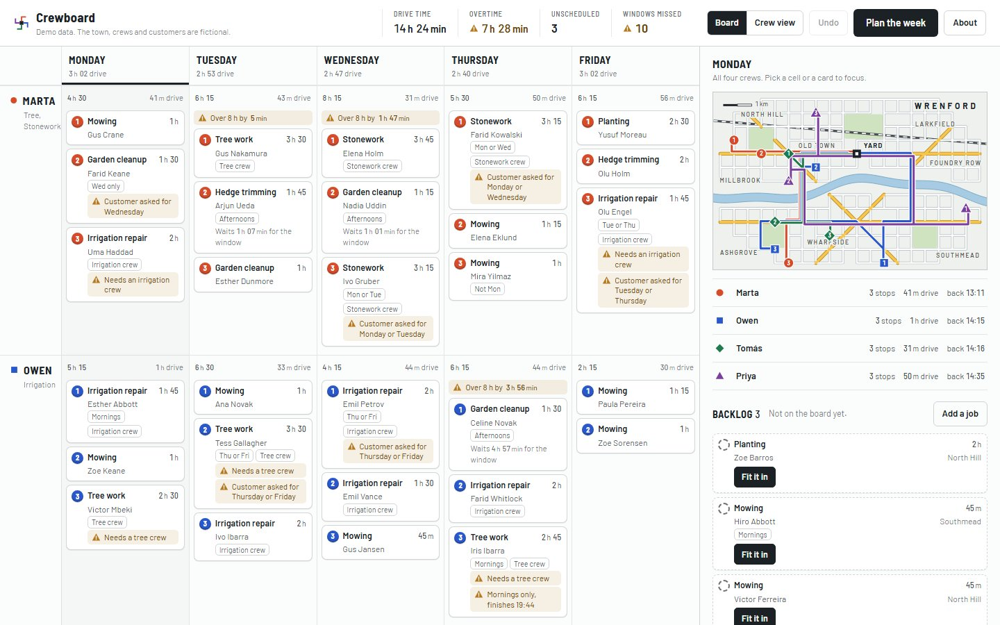
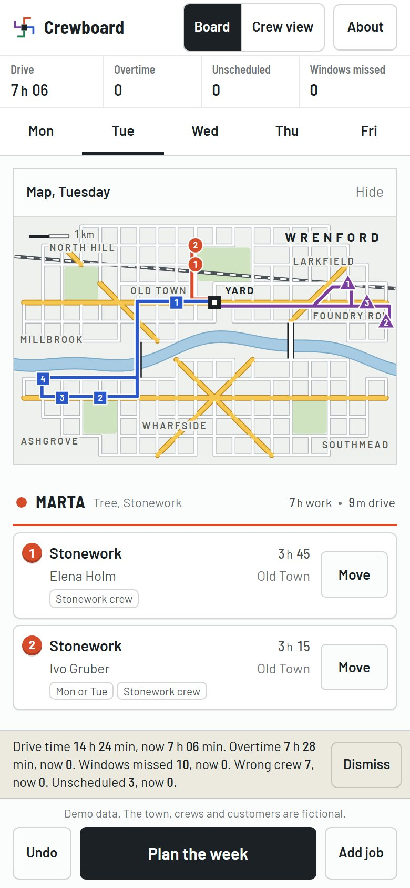

# Crewboard

A week planner for field crews that replans the whole board in one press.

**[Try it](https://michaelshadpour.com/try/crewboard)** | [Write-up](https://michaelshadpour.com/work/crewboard)





## What it is

Crewboard is a dispatch whiteboard for a four-crew grounds company: sixty jobs, five days, one fictional town. Drag a job between crews and days and every cost updates at once: drive time, overtime, missed time windows, jobs given to a crew without the right skill. Press Plan the week and the board reorganizes itself while the week's drive time counts down to the real optimized number.

What to try: press Plan the week and watch the cards move and the drive time drop. Then hold a card and drag it somewhere worse.

- **Desktop.** Drag cards with the mouse. A drop line and a live cost chip ("+7 min driving", "Adds 6 min of overtime") show the consequence before you let go. Day headers, cell headers and cards select what the map shows.
- **Phone.** A day switcher, four stacked crew lanes, a collapsible map, totals pinned at the top and Plan the week pinned at the bottom. Press and hold a card to drag it (hovering over a day tab switches day), or use Move for a sheet of valid destinations with the change in drive minutes for each.
- **Add a job.** Pick the type, length, district, customer, time of day and days. The job lands in the backlog. Fit it in places it at the cheapest valid spot and reports the added driving.
- **Crew view.** One crew's day in order, with the drive minutes between stops, the work times, a check box per stop, and the route on the map.
- **Undo, reset, saved state.** Undo steps back through your changes, Reset demo data (in About) restores the original week, and the week is kept in `localStorage`.
- **Self-running demo mode.** Open the page with `?attract=1` and it drags one card somewhere worse, presses Plan the week, and starts over. Any click, key press, scroll or touch hands control to you.

## How it works

- **Real road graph.** The town of Wrenford (213 junctions, 362 street segments) is generated from a seed: a grid with two diagonal avenues and two main streets, a river crossed only by two bridges, and parks that break the grid. All-pairs shortest paths (Dijkstra from every junction) give every drive time on screen, and the routes on the map follow the actual shortest paths. Unit tests check the triangle inequality, path reconstruction, and that every river crossing uses a bridge.
- **Optimizer in a worker.** A cell is one crew on one day. The optimizer starts with cheapest insertion that respects skills, day restrictions, time windows and the 8 hour day, from two starting points (an empty week and the current week repaired). Then it runs simulated annealing over relocate, swap, 2-opt and or-opt moves within and between cells. Only valid plans are ever accepted, and the result is never worse than its input. The budget is an iteration count with a seeded generator, so a given week always produces the same plan.
- **Seeded week, computed results.** The demo week starts as if jobs were entered in the order the phone rang. Plan the week takes it from 14 h 24 min of driving, 7 h 28 min of overtime, 10 missed windows, 7 wrong-crew jobs and 3 unscheduled jobs to 7 h 06 min of driving and zero of everything else. Nothing on screen is hard-coded: the before and after line is built from the two evaluations.
- **Streamed playback.** The worker posts improving plans as it finds them. The interface plays them back on a fixed schedule (construction first, then later improvements), with FLIP animation for every card and rolling totals, so the reorganization is readable instead of instant.
- **Speed.** Measured during development: 300,000 moves ran in about 180 to 210 ms in Chrome on the development machine. Under 4x CPU throttling the same run took 855 to 1004 ms (measured on the main thread, because Chrome's CPU throttling does not apply to Web Workers). First load was about 198 KB transferred.
- **Design.** A dispatch whiteboard: a white enamel surface, marker-gray rules, and jobs held up by crew-colored magnets that carry the stop number. The map is a road atlas: white streets with gray casings, yellow main roads, a blue river, green parks and an atlas rail line. The crew colors are vermilion, cobalt, pine and plum, and each crew also has a shape (circle, square, diamond, triangle) on the map, so crews stay distinct without color vision. Warnings are amber with an icon and words.

### Known limits

- The optimizer is a heuristic. After different manual edits it lands within a few percent of itself (a unit test checks under 8%), not on a proven optimum.
- Minimizing drive time can leave a crew with a free day. There is no workload-balancing rule.
- Afternoon jobs are modeled as "start at 13:00 or later". A crew that arrives early waits, and the wait counts toward the day.
- The landscape phone layout letterboxes the map.

## Stack

Vite 8, TypeScript (strict), Preact 11, one Web Worker. No backend, no runtime network requests, no service worker. Vitest for unit tests and Playwright (Chromium) for end-to-end tests.

## Run it

```
npm install
npm run dev          # http://localhost:5312
npm test             # Vitest: the unit tests in tests/unit/
npm run typecheck    # tsc --noEmit
npm run build        # production build in dist/, relative paths
npm run preview      # serves dist/ on http://localhost:5312
```

End-to-end tests:

```
npx playwright install chromium
npm run test:e2e     # builds, then runs Playwright against dist/
```

- `npm test` runs Vitest, which `vite.config.ts` limits to `tests/unit/**/*.test.ts`: 33 unit tests for the road graph, the cost model, the constraints, the optimizer and the move destinations.
- `npm run test:e2e` builds the app, then Playwright starts `scripts/serve.mjs` and runs `tests/e2e/` against the build served at `http://127.0.0.1:5312/dist/`. There are two Playwright projects: a touch phone at 390 x 844 and a desktop at 1440 x 900. The file holds 5 end-to-end tests, 2 written for the phone and 3 for the desktop, and each is skipped in the other project.
- `node scripts/checks.mjs` is an extra check to run after `npm run build`, with Chromium installed as above. It opens the build on a 360 px phone, a landscape phone and a tablet and fails on sideways scrolling or console errors, plans the week with reduced motion and inside an iframe, and prints the optimizer's run time under 4x CPU throttling. Its screenshots go to `shots/`, which Git ignores.

The dev server, the preview server and the end-to-end tests all use port 5312, so it has to be free.

## Layout

- `src/model/`: the town graph, the jobs, the cost model, the optimizer and the move destinations. No DOM code.
- `src/ui/`: the Preact components, drag and drop, FLIP animation, the store, the planner that plays back the worker's plans, and the self-running demo mode.
- `src/worker.ts`: runs the optimizer off the main thread.
- `tests/unit/` and `tests/e2e/`: the Vitest unit tests and the Playwright end-to-end tests.
- `scripts/`: the static server the end-to-end tests use, and the extra checks.
- `docs/`: the screenshots in this README.

## Credits and license

- Fonts: Barlow and Barlow Semi Condensed by Jeremy Tribby, SIL Open Font License 1.1, self-hosted from `@fontsource/barlow` and `@fontsource/barlow-semi-condensed` (latin subset; Barlow 400 to 700, Semi Condensed 500 to 700).
- Everything else in the app (town, map, magnets, icons, favicon) is drawn in code. It uses no pictures.
- Concept project. Crewboard is a fictional brand. Wrenford, its crews and its customers are demo data.
- Design and build: [Michael Shadpour](https://michaelshadpour.com).
- The code is under the MIT license. See [LICENSE](LICENSE).
